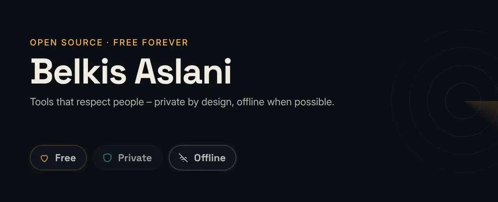

<a href="https://github.com/BEKO2210/spyhound">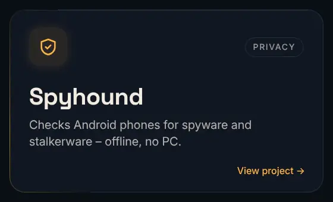</a> <a href="https://github.com/BEKO2210/european-alternatives.eu-free-open-source">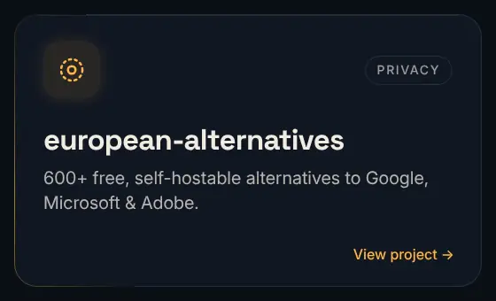</a> <a href="https://github.com/BEKO2210/nibra">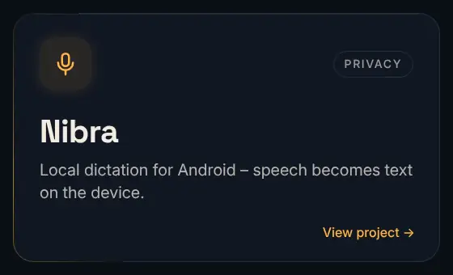</a> 
<a href="https://github.com/BEKO2210/Prepper_Log">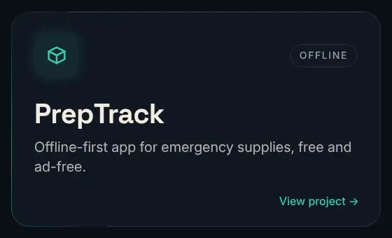</a> <a href="https://github.com/BEKO2210/rechenwerk">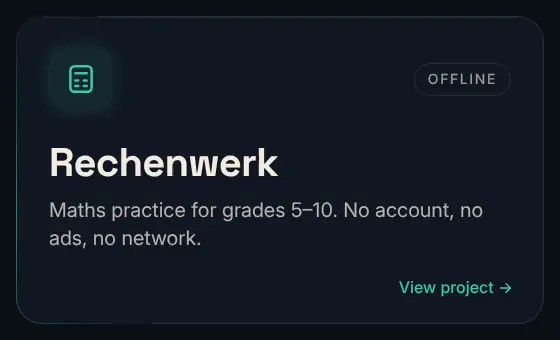</a> <a href="https://github.com/BEKO2210/foldpage-android">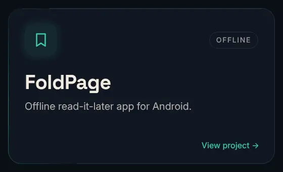</a> 
<a href="https://github.com/BEKO2210/cricket-brain">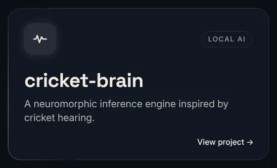</a> <a href="https://github.com/BEKO2210/statim">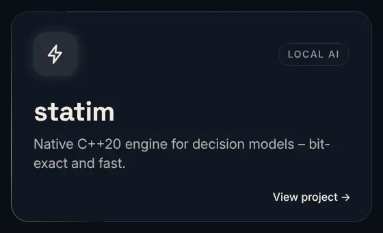</a> <a href="https://github.com/BEKO2210/motion-studio">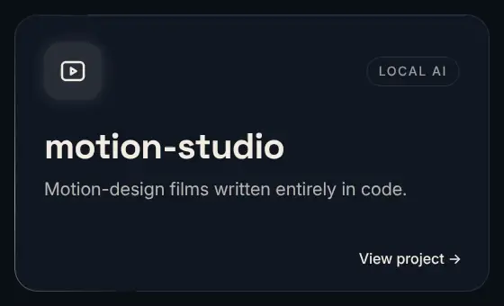</a> 

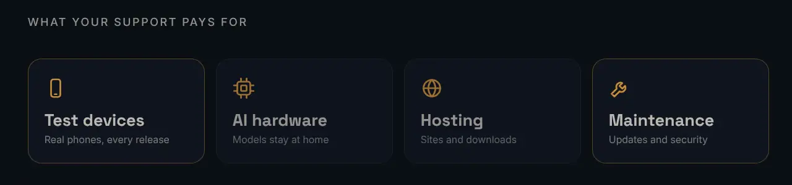

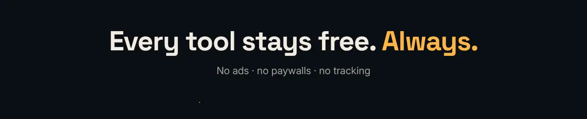
